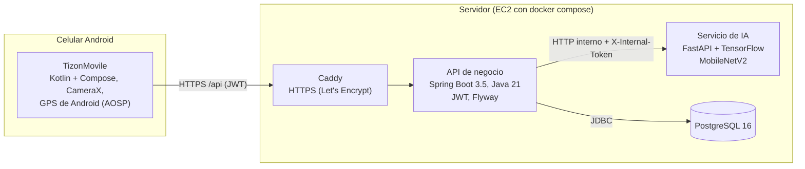
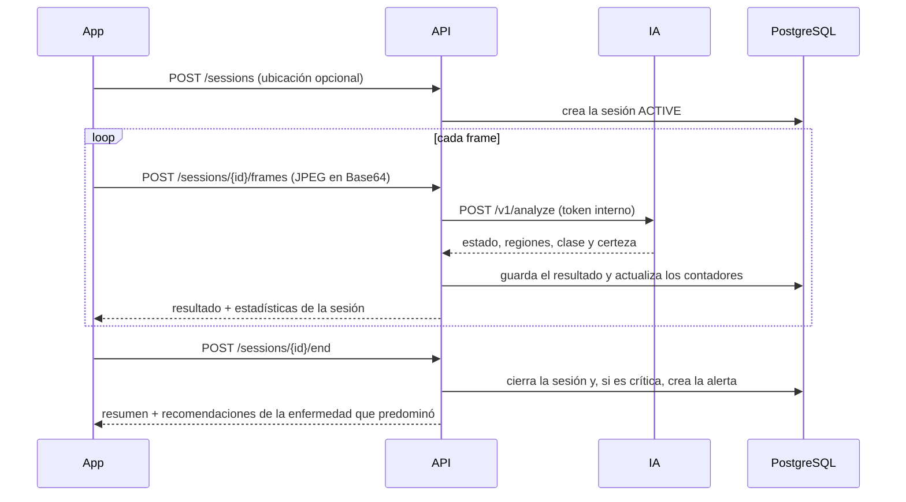

# Insumos para el documento académico (F7-04)

El PDF del documento no se reescribe. Este archivo reúne lo que los autores deben integrar: el alcance final, la
arquitectura real, la metodología, los resultados y las limitaciones. Los números están en
[resultados-metricas.md](resultados-metricas.md) (F7-02), con enlaces a cada reporte.

Estado al 24-oct-2026, rama `dev` de los tres repositorios.

## 1. Alcance final
**Qué hace el sistema** (decisión D-08 del 24-oct, que amplía el alcance original):
- Detecta en vivo, con la cámara de un celular Android, **tizón tardío** (*Phytophthora infestans*) y **tizón
  temprano** (*Alternaria solani*) en hojas de papa, y marca cada hoja con una caja, su diagnóstico y la certeza.
- **Discrimina si la hoja es de papa.** Si no lo es, avisa "No es una hoja de papa" y no analiza el tizón.
- Al finalizar un escaneo entrega un resumen: hojas analizadas, cuántas con cada tizón, porcentaje afectado,
  severidad (umbrales configurables de 10 % y 30 %) y **recomendaciones de la enfermedad que predominó**, cada una
  con su fuente.
- Gestiona usuarios con tres roles (agricultor, técnico y administrador), guarda la ubicación GPS de cada sesión
  (solo con permiso y con el proveedor de Android, sin Google Play Services), genera **alertas** cuando la severidad
  es crítica y muestra el historial de sesiones.

**Fuera del alcance (trabajo futuro):** identificación de malezas por especie, otras enfermedades de la papa,
drones y cámaras fijas, iOS, publicación en Play Store, notificaciones push con FCM y guardado de imágenes para
reentrenar.

## 2. Arquitectura real

- Solo Caddy publica puertos (80 y 443). La IA y la base de datos quedan en una red Docker interna.
- La IA no guarda imágenes: recibe el frame, responde y lo descarta. La API guarda solo los resultados.
- El contrato OpenAPI 3.1 (`contracts/tizon-api.yaml`) es la fuente de verdad de la API pública (app ↔ API) y de
  la interna (API ↔ IA). La IA y la API lo validan con pruebas de contrato; la app, con pruebas de deserialización
  de respuestas de ejemplo.
- **Estado del servidor:** el despliegue está listo en `deploy/` (compose, Caddy, scripts de arranque,
  actualización, respaldo y disponibilidad). La EC2 todavía no se creó (decisión del usuario, P-03). Todo se probó
  en local con el mismo `docker compose`.

Flujo de un frame:

## 3. Metodología

### 3.1 Desarrollo y aseguramiento de calidad
- Tres repositorios independientes (IA, API y app) y una rama `sistema` con la documentación, el contrato y el
  despliegue. Flujo de ramas `dev` → `qa` → `main`.
- **Contrato primero:** cada cambio de API actualiza primero `contracts/tizon-api.yaml` y luego las tres capas.
- **Integración continua** en GitHub Actions por repositorio: pruebas, linter y detección de secretos (gitleaks).
  Al integrar en `qa` o `main` se publica la imagen en GHCR. El servidor la toma por *pull* cada 5 minutos y vuelve a
  la versión anterior si la nueva no queda sana: GitHub nunca entra al servidor.
- **Seguridad:** sin secretos en git (se purgaron llaves antiguas del historial), JWT con roles, autorización por
  propiedad (un recurso ajeno responde 404), token interno entre la API y la IA, límite de intentos de login, límite de
  tamaño de petición y HTTPS.
- **Pruebas:** unitarias y de integración en las tres capas, pruebas de contrato, PostgreSQL real con Testcontainers,
  capturas automáticas de todas las pantallas (Roborazzi), una prueba de humo del sistema completo con imágenes reales
  y un guion de prueba en dispositivo (DISP-01 a DISP-99). La matriz de trazabilidad está en
  `docs/requerimientos/matriz-pruebas.md`.

### 3.2 Recomendaciones agronómicas
- Se toman de guías técnicas citables: ICA (2011), FHIA (2014) y Universidad de Wisconsin-Madison (2026). Ningún texto
  agrega datos que no estén en su fuente; no se nombran productos comerciales ni dosis, y el control químico remite
  siempre a un ingeniero agrónomo.
- Regla: el resumen muestra las de la enfermedad con más hojas afectadas en la sesión (en empate, tizón tardío).
- Trazabilidad completa en `docs/requerimientos/fuentes-recomendaciones.md`.

### 3.3 Datos
| Origen | Uso | Imágenes | Licencia |
|---|---|---|---|
| PlantVillage, carpeta `raw/color` del repositorio de GitHub (fotos de laboratorio: una hoja sobre fondo uniforme) | Entrenamiento, validación y prueba de laboratorio | Papa: 152 sanas, 1.000 con tizón temprano y 1.000 con tardío. Otras plantas: 1.050 hojas de 13 cultivos (más 440 sanas de 11 de esos cultivos en el candidato v2) | El repositorio no declara licencia; las imágenes no se redistribuyen |
| PlantDoc (fotos de internet en condiciones reales) | Prueba de campo; el candidato v2 también entrena con una parte | Papa con tizón: 108 temprano y 104 tardío (no hay papa sana); 554 de otras especies | CC BY 4.0 |

- El modelo original se entrenó con PlantVillage de Kaggle. Como ya no existían ni sus imágenes ni su notebook, no se
  podía evaluar con honestidad y se reentrenó (D-08).
- Partición estratificada 70/15/15 con semilla fija. Las fotos casi idénticas (hash perceptual, pHash) quedan en la
  misma partición, para que una hoja no esté a la vez en entrenamiento y en prueba.
- La partición queda versionada con el sha256 de cada archivo (`training/split.csv`), y el origen de cada imagen con su
  URL (`training/sources.csv`). Las imágenes se descargaron de forma temporal y se borraron al terminar.

### 3.4 Modelo y entrenamiento
- **Arquitectura:** MobileNetV2 preentrenada en ImageNet (transferencia de aprendizaje), con 4 salidas: sana, tizón
  temprano, tizón tardío y "no es papa". Esta última es interna y nunca se muestra como diagnóstico.
- **Preprocesamiento:** la normalización a [-1, 1] va dentro del modelo. El servicio solo redimensiona a 224×224 y pasa
  RGB, lo que evita el error clásico de preprocesar distinto al entrenar y al inferir.
- **Entrenamiento:**
  - aumento de datos (giros, rotación, zoom, brillo y contraste);
  - pesos por clase, porque hay pocas hojas sanas;
  - una fase con la base congelada y luego ajuste fino de los bloques 13 a 16;
  - parada temprana por la pérdida de validación.
- **Reproducibilidad:** Keras 3.15.1 y TensorFlow 2.16 en CPU. Cada modelo se identifica por su sha256, que la IA
  verifica al cargarlo.

### 3.5 Flujo de inferencia
1. **Filtro de vegetación (HSV):** acepta el verde, el amarillo de la clorosis unido al verde y las lesiones marrones
   unidas al tejido. Si no hay hoja suficiente, responde `NO_VEGETATION`, un resultado válido distinto de un error.
2. **Clasificación:** el modelo clasifica cada región de hoja.
3. **Resultado principal:** la clase más severa con una certeza de al menos 0,3. Si ninguna región es de papa, responde
   `NOT_POTATO` y no analiza el tizón.
4. **Cero fallas silenciosas:** un error técnico (modelo sin cargar, imagen inválida o IA caída) nunca se convierte en
   un diagnóstico.

### 3.6 Evaluación
- **Metas:** las del PDF.
  - Accuracy, precision, recall y F1 de al menos 90 %; especificidad de al menos 85 %; tasa de error de 10 % o menos.
  - Precision, recall, F1 y especificidad se calculan con el tizón tardío contra el resto. La accuracy es global.
- **Dos modos de medición:**
  - `classifier`: el modelo solo, con la imagen completa.
  - `pipeline`: el flujo real de `/v1/analyze`, que es lo que vive el usuario.
- **Dos sets de prueba:**
  - laboratorio: la partición de prueba de PlantVillage;
  - campo: PlantDoc, sin ninguna foto usada en el entrenamiento.
- **Lo que trae cada reporte:**
  - la matriz de confusión, las métricas por clase y la discriminación papa / otras plantas;
  - la latencia y las fotos repetidas frente al entrenamiento;
  - la lista de errores.
- **Intervalos:** los de confianza (Wilson, 95 %) se dan donde el set es pequeño.

## 4. Resultados (detalle y enlaces en [resultados-metricas.md](resultados-metricas.md))
| Medición | Meta | Resultado |
|---|---|---|
| Calidad en laboratorio (`pipeline`, 479 imágenes) | Metas del PDF | Accuracy 94,4 %, precision 94,8 %, recall 97,3 %, F1 96,1 % y especificidad 97,6 %: **cumple** |
| Calidad en campo (`pipeline`, 274 fotos de PlantDoc) | Metas del PDF | Modelo en uso: accuracy 73,7 %, recall de tizón tardío 6,2 %: **no cumple**. Rechaza como "no es papa" el 72,9 % de las hojas de papa |
| Candidato v2 en campo | Metas del PDF | Recall de tizón tardío 59,4 % y rechazo de papa 15,7 %, con las metas de laboratorio intactas: **mejora mucho, pero no cumple** |
| Tiempo de respuesta | ≤ 5 s | 0,39 s (p95) en local sin red móvil; falta el dispositivo |
| Funcionalidades verificadas | ≥ 90 % | 100 % (8 de 8) |
| Disponibilidad y usabilidad | ≥ 95 % y SUS ≥ 85 | Pendientes de la EC2 y de la encuesta |

## 5. Limitaciones (para la discusión)
- **Calidad en campo:**
  - El modelo cumple las metas con fotos de laboratorio, pero no con fotos de campo. La brecha es la limitación conocida
    de los modelos entrenados con PlantVillage.
  - El candidato v2 la reduce, pero no la cierra. Ninguno de los dos llega al 90 % en campo.
- **Lo que no se pudo medir:**
  - Cuántas hojas sanas se marcarían como enfermas en el cultivo, porque no hay fotos de campo de papa sana.
  - Las malezas, porque la clase "no es papa" no las conoce: solo vio 13 cultivos y algunas especies de PlantDoc.
- **Sets de campo:** PlantDoc tiene etiquetas con ruido y fotos de internet, no las del celular de la prueba. Los sets
  de campo son pequeños: 32 hojas de tizón tardío.
- **Pendientes de medir:**
  - el tiempo de respuesta en el dispositivo, la disponibilidad en la EC2 y la usabilidad (SUS);
  - las pruebas de cámara, GPS y notificaciones, que solo se confirman en el dispositivo.
- **Recomendaciones:** resumen guías técnicas citables, pero un ingeniero agrónomo no ha revisado el resumen.

## 6. Trabajo futuro
- Set propio de fotos de campo del cultivo, con hojas sanas y malezas (protocolo listo en
  `docs/requerimientos/protocolo-fotos-campo.md`). Usarlo primero para medir y luego para reentrenar.
- Evaluar datasets abiertos de campo que incluyen papa sana, verificando antes su licencia: Shabrina et al. (2023), y
  "Potato Leaf (Healthy and Late Blight)", ambos en Mendeley Data.
- Identificación de malezas por especie, otras enfermedades de la papa y localización de la lesión (Grad-CAM).
- Drones o cámaras fijas en el cultivo.
- Modelos o umbrales por región, con datos locales.

## 7. Referencias
- Hughes, D. P. y Salathé, M. (2015). *An open access repository of images on plant health to enable the development
  of mobile disease diagnostics*. arXiv:1511.08060 (PlantVillage).
- Mohanty, S. P., Hughes, D. P. y Salathé, M. (2016). *Using Deep Learning for Image-Based Plant Disease Detection*.
  Frontiers in Plant Science, 7:1419.
- Singh, D., Jain, N., Jain, P., Kayal, P., Kumawat, S. y Batra, N. (2020). *PlantDoc: A Dataset for Visual Plant
  Disease Detection*. CoDS-COMAD 2020 (PlantDoc, CC BY 4.0).
- Sandler, M., Howard, A., Zhu, M., Zhmoginov, A. y Chen, L.-C. (2018). *MobileNetV2: Inverted Residuals and Linear
  Bottlenecks*. CVPR 2018.
- Instituto Colombiano Agropecuario, ICA (2011). *Manejo fitosanitario del cultivo de la papa: medidas para la
  temporada invernal*. Código 00.09.31.11.
- Rivera C., J. M., Brown, J. K., Weller, S. y Melgar, J. C. (2014). *Consideraciones técnicas para el efectivo manejo
  integrado del tizón tardío en papa*. FHIA, Honduras.
- Gevens, A., Abbrescia, A., Groves, R. y Bradford, B. *Potato Early Blight*. UW Vegetable Pathology, University of
  Wisconsin-Madison (actualizado el 24-ago-2026).
- Shabrina et al. (2024). *A novel dataset of potato leaf disease in uncontrolled environment*. Data in Brief, 52:109955
  (dataset en Mendeley Data, 2023).
